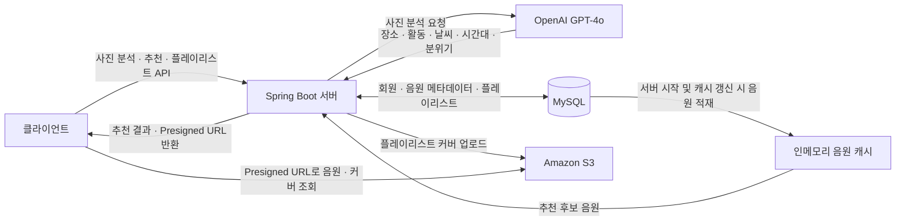

## 🎧 Soundscape | 사진 속 분위기를 음악으로 만나요

### 사진 한 장으로 공간과 순간에 어울리는 음악을 추천하는 AI 음악 큐레이션 서비스

Soundscape는 사진 속 장소와 분위기를 분석해 그 순간에 어울리는 음악을 추천합니다.
카페에서 공부할 때, 비 오는 풍경을 바라볼 때, 여행지에서 휴식할 때처럼 다양한 순간을 사진으로 담고, 추천받은 음악을 나만의 플레이리스트로 저장할 수 있습니다.

이 저장소는 Soundscape의 **백엔드 API 서버**입니다.

### Tech Stack

#### Backend

  

#### AI / LLM

#### Database

#### Infrastructure / Storage

 

### Service Architecture

GPT-4o가 사진을 분석하면 서버가 분석 결과와 등록된 음원의 분위기·테마를 비교해 추천 곡을 선정합니다. 음원 파일과 플레이리스트 커버는 Amazon S3에 저장하며, 클라이언트에는 유효기간이 있는 접근 주소인 Presigned URL을 제공합니다.

### Key Features

#### 📸 AI 사진 분석

- 업로드한 사진에서 장소, 활동, 날씨, 시간대와 분위기를 분석
- 밝기, 에너지, 차분함, 따뜻함, 긍정성, 몽환성의 6가지 수치로 사진의 분위기를 표현
- 분석한 분위기에 어울리는 플레이리스트 제목 생성

#### 🎵 분위기 기반 음악 추천

- 사진과 음원의 분위기 유사도 및 테마 일치도를 비교해 최대 5곡 추천
- 공부·집중, 휴식·힐링, 산책·드라이브·여행 등 사진에 어울리는 테마를 자동 선택
- **분위기 유사도 70% + 테마 일치도 30%**를 반영한 점수로 추천 순서 결정

> 추천은 서비스에 등록된 음원을 대상으로 합니다.

#### 💿 나만의 플레이리스트

- 추천받은 음악 5곡을 사진과 함께 플레이리스트로 저장
- 업로드한 사진을 플레이리스트 커버로 활용
- 사용자별 플레이리스트 목록·상세 조회 및 삭제
- 음원 접근 URL과 곡 순서를 제공해 클라이언트의 재생 기능 지원

#### 👤 회원가입 및 로그인

- 아이디, 비밀번호, 닉네임을 이용한 회원가입과 로그인
- BCrypt로 비밀번호를 해시하여 저장
- 현재 MVP는 로그인 응답의 사용자 ID를 `X-User-Id` 헤더로 전달하는 방식이며, 세션·JWT 인증은 구현되어 있지 않음

### Backend Highlights

- **음원 메타데이터 캐싱**: 서버 시작 시 음원 정보를 메모리에 적재하여 추천 과정의 반복적인 DB 조회를 줄임
- **이미지 전처리**: AI 분석 전 사진의 최대 변을 기본 512px로 축소하여 전송 크기를 줄임
- **추천 요청 제한**: 요청 IP를 기준으로 사진 추천을 분당 10회로 제한
- **캐시 갱신 API**: 음원 추가 후 서버 재시작 없이 추천 후보 데이터를 다시 적재

### Documentation

- [실행 방법 · API 명세 · 추천 알고리즘](docs/BACKEND_GUIDE.md)
- [회원가입 · 로그인 API 연동 가이드](docs/AUTH_API_HANDOFF.md)
- [트러블슈팅 기록](TROUBLESHOOTING.md)

> 실행 및 API 가이드는 기존 README를 보존한 문서입니다. 문서에 기록된 배포 주소·운영 일정·음원 수는 작성 당시 기준이며, 현재 운영 상태를 보장하지 않습니다.
