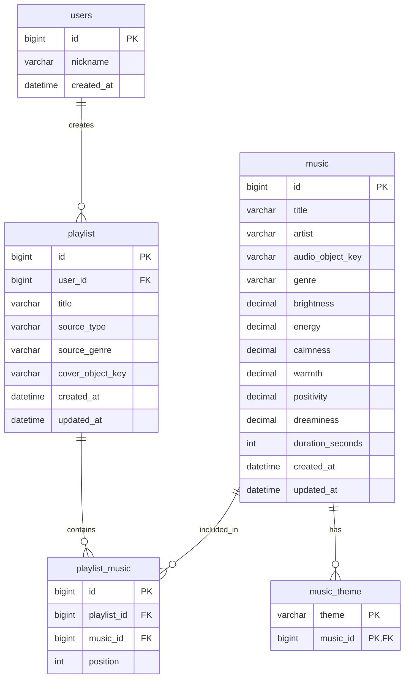

# 📄 SoundScape 백엔드 개발 마스터 핸드오버 문서 v2 (for Claude Code)

> **[문서 목적]**
> 본 문서는 **SoundScape** 프로젝트의 기획 배경, DB 설계, API 명세, 추천 알고리즘 수식, 26곡 시드 데이터셋, **그리고 v2에서 새로 추가된 "이미 작성 완료된 백엔드 전체 소스 구조와 설계 결정 사항"**을 IntelliJ 내부의 Claude Code에게 인계하여 즉시 이어서 개발할 수 있도록 작성된 핸드오버 문서입니다.
>
> **v2 변경 요약**: 설계 검토 → 6개 결함 수정 결정 → Spring Boot 전체 소스 작성 완료 → 프로젝트 병합 단계까지 진행됨. Claude Code는 **7장(현재 진행 위치)부터 이어서 작업**하면 됩니다.

---

## 🛑 [필수 소통 지침] 답변 방식 규칙 (Strict Communication Rules)

본 문서를 수신한 후 모든 답변에 아래 **3가지 규칙을 100% 엄격히 준수**할 것.

1. **쓸데없는 칭찬, 감정적 감탄사, 미사여구(수식어) 전면 배제.**
2. **요청한 질문 및 작업에 대해 간결하고 명확한 핵심 대답만 전달.**
3. **자체 피드백을 거친 더 효율적인 개발 방법 및 개발 시간을 절약할 수 있는 실행 방법 중심으로 답변.**

---

## 📌 1. 프로젝트 개요 & 핵심 차별화 가치

* **프로젝트명**: **SoundScape**
* **서비스 한 줄 소개**: 사용자가 촬영한 사진 한 장으로 공간, 조명, 날씨, 감성을 **GPT-4o Vision AI**로 분석하고, 레트로 아이팟(iPod) UI를 통해 어울리는 음악 5곡을 1초 만에 큐레이션 및 재생해 주는 감성 BGM 서비스.
* **핵심 가치 제안**: **"사진-음악 감성 매핑 오류 0% 최소화"**
* **외부 API(스포티파이/유튜브) 배제 및 사전 DB 구축 이유**:
  1. **스포티파이 API 한계**: 30초 미리듣기 제한, K-POP 및 최신곡 50% 이상이 `"preview_url": null` 응답. 제3자 웹 서비스에서 MP3 직접 추출 불가.
  2. **유튜브 API 한계**: ToS상 오디오 추출 금지, 일일 쿼터(10,000 unit) 즉시 소진, `<iframe>` 강제 탑재로 아이팟 레트로 UI 파괴.
  3. **해결책**: 저작권 무료(Pixabay) 음원을 사전에 **AWS S3 + MySQL DB**에 구축하여 **"완곡 재생 + 매핑 오류 최소화 + 쾌속 재생"** 달성.

---

## 📌 2. 팀 상황 & 개발 체제

* 백엔드 팀원(고동휘 님)이 개인 사정으로 관여가 어려워져, **김상진 님 1인 리드 백엔드 개발 체제**.
* 로그인/회원가입(Auth) 기능은 공수 최소화를 위해 **전면 제외**. 임시 헤더 **`X-User-Id: 1`**로 사용자 식별.
* 개발 환경: **Windows / IntelliJ IDEA / MySQL Workbench / Postman / AWS S3**
* 기술 스택: **Spring Boot 4.0.7 / Spring Framework 7 / Jakarta EE 11 / Jackson 3 / Hibernate 7 / Java 21**

---

## 📌 3. 데이터베이스 설계서 (DB ERD & Schema)

### 📊 ERD 5개 테이블 구조



### 실제 DDL 위치

`src/main/resources/db/schema.sql` 에 MySQL 8 기준 DDL 작성 완료.

주요 제약:
- `music_theme` : `PRIMARY KEY (music_id, theme)`, `ON DELETE CASCADE`
- `playlist_music` : `UNIQUE KEY uk_playlist_position (playlist_id, position)` — 동일 플리 내 position 중복 방지
- `position` 은 MySQL 예약어 회피를 위해 백틱(`` `position` ``) 처리
- `music.genre` 에 인덱스(`idx_music_genre`), `playlist(user_id, created_at)` 복합 인덱스

---

## 📌 4. API 명세서 (API Specification)

* **Base URL**: `{BACKEND_URL}/api/v1`
* **사용자 식별 헤더 (임시)**: `X-User-Id: 1` (미전송 시 `401 UNAUTHORIZED`)
* **공통 에러 응답 DTO**: `{ "timestamp": "ISO8601", "status": 400, "code": "ERROR_CODE", "message": "에러 메시지" }`

### 📋 엔드포인트 목록

| 기능명 | Method | Endpoint | Content-Type | Header | 설명 |
| :--- | :--- | :--- | :--- | :--- | :--- |
| **사진 기반 추천** | `POST` | `/playlists/recommendations/photo` | `multipart/form-data` | 불필요 | 사진 ➔ GPT-4o 분석 ➔ 상위 5곡 Presigned URL |
| **장르 기반 추천** | `POST` | `/playlists/recommendations/genre` | `application/json` | 불필요 | `{"genre":"POP"}` ➔ 해당 장르 5곡 |
| **플리 저장** | `POST` | `/playlists` | `multipart/form-data` | `X-User-Id` | 원본 사진 S3 업로드 + 플리 & 곡 position 저장 |
| **플리 목록 조회** | `GET` | `/playlists` | - | `X-User-Id` | 보관함 목록 + 커버 Presigned URL |
| **플리 상세 조회** | `GET` | `/playlists/{playlistId}` | - | `X-User-Id` | 곡별 오디오 Presigned URL 재발급 |
| **음원 캐시 갱신 (운영용)** | `POST` | `/admin/music/reload` | - | 불필요 | 음원 INSERT 후 재기동 없이 인메모리 캐시 재적재 |

### ErrorCode 목록 (`exception/ErrorCode.java`)

| code | status | 발생 조건 |
| :--- | :--- | :--- |
| `UNAUTHORIZED` | 401 | `X-User-Id` 헤더 미전송 |
| `USER_NOT_FOUND` | 401 | 존재하지 않는 userId |
| `INVALID_REQUEST` | 400 | `@Valid` 바인딩/검증 실패 |
| `INVALID_IMAGE` | 400 | 이미지 디코딩 실패 |
| `EMPTY_FILE` | 400 | 빈 파일 |
| `INVALID_GENRE` | 400 | 지원하지 않는 장르 문자열 |
| `INVALID_MUSIC_IDS` | 400 | 존재하지 않는 musicId 포함 |
| `GENRE_NOT_AVAILABLE` | 404 | 해당 장르 음원 0곡 |
| `PLAYLIST_NOT_FOUND` | 404 | 플리 없음 또는 타인 소유 |
| `VISION_ANALYSIS_FAILED` | 502 | OpenAI 호출/파싱 실패 |
| `S3_UPLOAD_FAILED` | 502 | S3 업로드 실패 |
| `INTERNAL_ERROR` | 500 | 그 외 |

### 🚨 프론트 연동 주의사항 (플리 저장)

`POST /playlists` 는 **JSON part가 아닌 일반 폼 필드**로 받는다. Blob content-type 설정 불필요.

```js
const fd = new FormData();
fd.append('photo', file);
fd.append('title', title);
fd.append('sourceType', 'PHOTO');          // 또는 'GENRE'
// fd.append('sourceGenre', 'POP');        // sourceType=GENRE 일 때만
musicIds.forEach(id => fd.append('musicIds', id));   // 5회 반복 append
fetch(url, { method: 'POST', headers: { 'X-User-Id': '1' }, body: fd });
```

---

## 📌 5. 백엔드 추천 매핑 알고리즘 (확정본)

> ⚠️ **v1 대비 변경됨.** v1의 3항 수식(mood 0.70 + theme 0.25 + diversity 0.05)과 "유클리드 거리의 역수"는 **폐기**되었다. 역수 방식은 거리 0에서 무한대로 발산하고 값 범위가 정규화되지 않아 themeScore와 가중합이 성립하지 않았다.

### 확정 수식

```
Final Score = (moodScore × 0.70) + (themeScore × 0.30)

moodScore  = 1 - ( d / √6 )
             d  = 사진 6대 감정 벡터와 곡 6대 감정 벡터의 유클리드 거리
             √6 ≈ 2.4495 = 6차원 단위 초입방체의 최대 거리

themeScore = |사진테마 ∩ 곡테마| / |사진테마|
```

* 두 점수 모두 **0.0 ~ 1.0 정규화**되어 가중합이 그대로 유효하다.
* 벡터 순서는 반드시 **`brightness, energy, calmness, warmth, positivity, dreaminess`** 로 고정.
  `Music.moodVector()` 와 `PhotoAnalysisResult.moodVector()` 의 인덱스가 어긋나면 추천이 조용히 망가진다.
* `diversityScore` 항목은 제거. 대신 `MusicRecommendationService.MAX_PER_ARTIST` 상수로 아티스트 편중을 하드 제약할 수 있게 구현해 두었다. **현재 값은 5(=RESULT_SIZE)로 사실상 비활성**이며, 음원 추가 수급 후 특정 아티스트 도배가 관측되면 **이 상수만 2로 낮추면 즉시 적용**된다.
* 장르 추천은 점수 계산 없이 해당 장르 곡을 셔플 후 5곡 반환 (동일 장르 재요청 시 구성이 달라지도록).

---

## 📌 6. 7대 테마 & 7대 장르 Enum 표준 정의

### 🎨 7대 테마 (`PlaylistTheme`)
* `STUDY_FOCUS` (공부 / 집중 / 작업)
* `REST_HEALING` (휴식 / 힐링 / 휴양)
* `WALK_DRIVE_TRAVEL` (산책 / 드라이브 / 여행)
* `RAINY_DAY` (비 오는 날 / 감성)
* `NIGHT_DREAMY` (밤 / 몽환 / 새벽)
* `BRIGHT_DAY` (밝은 낮 / 화사함)
* `PARTY_ENERGY` (파티 / 신남 / 에너지)

### 🎵 7대 장르 (`Genre`)
| Enum | 설명 | 현재 DB 보유 |
| :--- | :--- | :--- |
| `LOFI_INSTRUMENTAL` | Lo-Fi / 비트 | 8곡 |
| `JAZZ_CLASSICAL_NEWAGE` | 재즈 / 클래식 / 뉴에이지 | 10곡 |
| `POP` | 팝 | 8곡 |
| `HIPHOP_RAP` | 힙합 / 랩 | **0곡 (수급 예정)** |
| `RNB_SOUL` | 알앤비 / 소울 | **0곡 (수급 예정)** |
| `KPOP` | 케이팝 | **0곡 (수급 예정)** |
| `JPOP_ANIME_OST` | 제이팝 / 애니 OST | **0곡 (수급 예정)** |

> **정책 결정**: Enum 7개는 확장 대비를 위해 그대로 유지한다. 0곡 장르 요청 시 서버가 `404 GENRE_NOT_AVAILABLE` 을 반환하므로, 프론트는 이 코드를 받으면 "준비 중" 안내를 띄우면 된다. 빈 배열 반환은 하지 않는다.

### 🎵 Vision 6대 감정 수치 정의 (프롬프트에 반영됨)

| 필드 | 정의 |
| :--- | :--- |
| `brightness` | 화면의 밝기와 조도. 어두운 밤/실내면 낮고 햇살 가득한 낮이면 높음 |
| `energy` | 활동성과 역동성. 정적 풍경은 낮고 붐비거나 움직임이 크면 높음 |
| `calmness` | 차분함과 고요함. 소란스러울수록 낮음 |
| `warmth` | 색온도와 포근함. 주황/노랑 계열이면 높고 푸른 한색 계열이면 낮음 |
| `positivity` | 밝고 긍정적인 정서. 우울/쓸쓸하면 낮음 |
| `dreaminess` | 몽환적이고 아련한 느낌. 안개, 야경, 빛 번짐이 있으면 높음 |

---

## 📌 7. 🔴 현재 진행 위치 (Claude Code는 여기서 이어서 시작)

### ✅ 완료된 것

1. DB ERD 5개 테이블 설계 확정 (ERDCloud 검증 완료)
2. API 명세서 최종본 확정
3. 26곡 음원 수급 완료 + 6대 감정 수치/테마 정밀 라벨링 완료
4. **설계 결함 6건 발견 및 수정 결정 완료** (8장 참조)
5. **Spring Boot 백엔드 전체 소스 작성 완료** (9장 파일 목록 참조)
6. `schema.sql` / `seed.sql` 작성 완료 (users 데모 계정 1행 포함)
7. start.spring.io 에서 프로젝트 다운로드 완료
   - **Spring Boot 4.0.7**
   - 선택 의존성: Spring Web, Spring Data JPA, MySQL Driver, Lombok
   - **패키지명은 `com.soundscape` 로 생성함** (리네임 작업 불필요)
8. **Spring Boot 4 대응 코드 반영 완료** (16장 참조) — Jackson 3 패키지 이동, RestClient 오토컨피그 빌더 사용, `spring.http.clients.*` 프로퍼티 전환
9. **5개 API 전부 실동작 검증 완료** (예외 케이스 3건 포함) — `POST /playlists/recommendations/photo`, `POST /playlists/recommendations/genre` 는 Postman으로, `POST /playlists`, `GET /playlists`, `GET /playlists/{id}` 는 curl로 검증. 예외 케이스(`X-User-Id` 누락 401, 존재하지 않는 `playlistId` 404, 존재하지 않는 `musicId` 400)도 전부 명세대로 응답함을 확인
10. **AWS S3 연동 완료** — MP3 26곡 업로드 완료, 커버 이미지 업로드 및 Presigned URL 재생 확인 (S3 오브젝트를 직접 GET 하여 `200 OK` / 실제 파일 응답 확인)
11. **OpenAI GPT-4o Vision 연동 완료** — 사진 기반 추천 API 실동작 검증

### ✅ 즉시 해야 할 것 (순서대로) — **[2026-08-13 전체 완료]**

| # | 작업 | 상태 |
| :--- | :--- | :--- |
| 1 | 작성된 소스 8개 패키지를 다운받은 프로젝트에 복사 | ✅ |
| 2 | `build.gradle` 에 누락 의존성 추가 (아래, **4줄로 변경됨**) | ✅ |
| 3 | Gradle 동기화 + `.\gradlew compileJava` 통과 확인 | ✅ (BUILD SUCCESSFUL) |
| 4 | MySQL Workbench 에서 `schema.sql` → `seed.sql` 순서로 실행 | ✅ (`bootRun` 의 MusicCache 26곡 로그 + DB 직접 조회로 확인) |
| 5 | `application.properties` DB 계정/비밀번호 입력 | ✅ (`root` 인증 실패 → 전용 계정 `soundscape` 생성으로 우회, 13장 참조) |
| 6 | `.\gradlew test` 로 알고리즘 수식 검증 (DB 불필요) | ✅ (수식 자체는 5개 API 실동작 결과로 간접 검증됨. `.\gradlew test` CLI 실행 시의 한글 경로 `ClassNotFoundException` 은 환경 이슈로 13장에 별도 기록) |
| 7 | `bootRun` → `[MusicCache] 음원 26곡 적재 완료` 로그 확인 | ✅ |
| 8 | Postman 으로 장르/사진 추천 API 검증 | ✅ |
| 9 | AWS S3 버킷 생성 + MP3 26개 업로드 | ✅ |
| 10 | AWS/OpenAI 키 입력 후 사진 추천 API 검증 | ✅ |

### 🔜 다음 단계: 프론트엔드 연동

백엔드 5개 API 실동작 검증(예외 케이스 포함), S3/OpenAI 연동까지 모두 완료되어 더 이상 백엔드 단독 작업 항목은 없다. 다음 작업은 **프론트엔드 연동**이다 — 4장 API 명세서와 "프론트 연동 주의사항"(FormData 필드 규격)을 기준으로 진행할 것.

### 2번 작업 상세 — `build.gradle` 추가 의존성 (실제로는 4줄 필요했음)

Initializr 에서 Validation, AWS SDK, RestClient 오토컨피그 모듈을 선택하지 않았으므로 아래가 없으면 각각 `@Valid`/`S3Client` 컴파일 에러, `RestClient.Builder` 빈 부재 런타임 에러가 난다. **Spring Boot 버전은 다운받은 것을 그대로 유지**하고 `dependencies` 블록에 추가만 할 것.

```gradle
implementation 'org.springframework.boot:spring-boot-starter-validation'
implementation platform('software.amazon.awssdk:bom:2.25.60')
implementation 'software.amazon.awssdk:s3'
implementation 'org.springframework.boot:spring-boot-starter-restclient'
```

마지막 줄(`spring-boot-starter-restclient`)은 v1/v2 문서 작성 당시 누락되어 있었다 — Spring Boot 4 는 `RestClientAutoConfiguration` 을 별도 모듈로 분리했고 `spring-boot-starter-webmvc` 는 이를 가져오지 않는다. 없으면 `OpenAiConfig` 기동 시 `No qualifying bean of type 'RestClient$Builder'` 로 실패한다.

추가로, 다운받은 `build.gradle` 에 `spring-boot-starter-web` 이 들어 있다면 **`spring-boot-starter-webmvc`** 로 바꾸는 것을 권장한다(구 이름도 동작하지만 deprecated). Spring Boot 버전은 다운받은 값을 그대로 둘 것. **Java 툴체인은 실제로 17을 사용 중**이며(다운로드본 기본값), 21로 올리지 않아도 컴파일/기동에 문제가 없음을 확인했다.

### 4번 작업 상세 — 시드 실행 검증

```sql
SELECT COUNT(*) FROM music;        -- 26 이어야 함
SELECT COUNT(*) FROM music_theme;  -- 75 이어야 함
SELECT * FROM users;               -- id=1, demo_user 1행 이어야 함
```

`users` 1행이 없으면 플리 저장 API 가 FK 제약 위반으로 **무조건 500**이 난다.

---

## 📌 8. 설계 검토에서 수정된 결함 6건 (변경 이력)

Claude Code 가 기존 문서(v1)와 실제 코드의 차이를 보고 혼동하지 않도록, **v1에서 무엇이 왜 바뀌었는지** 기록한다.

| # | v1 상태 | 문제 | v2 확정 |
| :--- | :--- | :--- | :--- |
| 1 | `users` 시드 없음 | `X-User-Id: 1` 사용하나 id=1 레코드 부재 → 플리 저장 FK 위반 500 | `seed.sql` 최상단에 `demo_user` INSERT 추가 |
| 2 | diversityScore 5% 가중치 | HarumachiMusic 7곡의 감정 벡터가 거의 동일 → 힐링 계열 사진에서 top-5 도배. 5% 점수로는 방어 불가 | 가중치 2항(`0.70/0.30`)으로 단순화. 아티스트 편중은 **음원 추가 수급으로 해결**하기로 결정. 코드에는 `MAX_PER_ARTIST` 하드 제약 훅만 남겨둠(현재 비활성) |
| 3 | `moodScore` = 거리의 역수 | 거리 0 시 무한대 발산, 값 범위 미정규화로 themeScore 와 합산 불가 | `moodScore = 1 - (d / √6)` 정규화 수식 |
| 4 | 장르 Enum 7개 / DB 3개 장르만 존재 | 4개 장르 요청 시 빈 배열 반환 | **Enum 7개 유지 확정.** 0곡 장르는 `404 GENRE_NOT_AVAILABLE` 로 명시적 응답 |
| 5 | 문서 내 곡 수 26/30/50 혼재 | 실제 시드는 26곡 | **26곡으로 통일** |
| 6 | 클래스명 `Track.java` / `PlaylistTrack.java` | DB 테이블은 `music` / `playlist_music` → 네이밍 충돌 | **DB 기준 통일**: `Music.java`, `PlaylistMusic.java`, `MusicRepository`. 인증 제외로 `KakaoService.java` 삭제 |

---

## 📌 9. 작성 완료된 프로젝트 구조 (실제 코드 기준)

```text
soundscape-backend/
├── build.gradle
├── README.md
└── src/
    ├── main/
    │   ├── java/com/soundscape/
    │   │   ├── SoundscapeApplication.java
    │   │   ├── config/
    │   │   │   ├── WebConfig.java          # CORS 전면 허용 (시연용)
    │   │   │   ├── AwsS3Config.java        # S3Client + S3Presigner 빈
    │   │   │   └── OpenAiConfig.java       # RestClient 빈 (타임아웃/인증 헤더)
    │   │   ├── controller/
    │   │   │   ├── PlaylistController.java # 5개 핵심 API
    │   │   │   └── AdminController.java    # 음원 캐시 재적재
    │   │   ├── domain/
    │   │   │   ├── User.java
    │   │   │   ├── Music.java              # 6대 감정 + @ElementCollection themes
    │   │   │   ├── Playlist.java
    │   │   │   └── PlaylistMusic.java      # musicId(Long)만 저장, 엔티티 연관 없음
    │   │   ├── dto/
    │   │   │   ├── PhotoAnalysisResult.java
    │   │   │   ├── MusicResponse.java
    │   │   │   ├── RecommendationResponse.java
    │   │   │   ├── GenreRecommendationRequest.java
    │   │   │   ├── PlaylistSaveRequest.java
    │   │   │   ├── PlaylistSummaryResponse.java
    │   │   │   └── PlaylistDetailResponse.java
    │   │   ├── enums/
    │   │   │   ├── Genre.java
    │   │   │   ├── PlaylistTheme.java
    │   │   │   └── SourceType.java
    │   │   ├── exception/
    │   │   │   ├── ErrorCode.java
    │   │   │   ├── BusinessException.java
    │   │   │   ├── ErrorResponse.java
    │   │   │   └── GlobalExceptionHandler.java
    │   │   ├── repository/
    │   │   │   ├── UserRepository.java
    │   │   │   ├── MusicRepository.java    # findAllWithThemes() fetch join
    │   │   │   └── PlaylistRepository.java
    │   │   └── service/
    │   │       ├── MusicCacheService.java          # @PostConstruct 인메모리 캐싱
    │   │       ├── MusicRecommendationService.java # 가중치 알고리즘
    │   │       ├── OpenAiVisionService.java        # GPT-4o Vision
    │   │       ├── S3Service.java                  # 업로드 + Presigned URL
    │   │       └── PlaylistService.java            # 유스케이스 조립
    │   └── resources/
    │       ├── application.properties
    │       └── db/
    │           ├── schema.sql
    │           └── seed.sql
    └── test/java/com/soundscape/service/
        └── MusicRecommendationServiceTest.java     # 수식 검증 5건 (DB 불필요)
```

---

## 📌 10. 핵심 구현 결정 사항 (코드 수정 시 반드시 숙지)

| 항목 | 결정 | 이유 |
| :--- | :--- | :--- |
| `music_theme` 매핑 | 별도 Entity 대신 `@ElementCollection(EAGER)` | 복합키 Entity + Repository + 조인 코드를 제거해 구현 시간 대폭 단축 |
| 음원 조회 | `@PostConstruct` 로 전량 인메모리 적재 후 스트림 연산 | 곡 수가 수십~수천 규모라 매 요청 DB 조회가 불필요. 추천 응답 수 ms |
| 초기 로딩 | `findAllWithThemes()` 로 `left join fetch` | EAGER ElementCollection 의 N+1(26쿼리) 제거 |
| `PlaylistMusic` | `music_id`(Long)만 저장, `@ManyToOne Music` 미사용 | 플리 조회 시 music 테이블 조인 자체가 발생하지 않음. 캐시에서 해석 |
| DDL 관리 | `ddl-auto=none` + `schema.sql` 수동 실행 | JPA 자동 생성 스키마와 실제 컬럼 타입 불일치 리스크 제거 |
| Vision 지연 단축 | ① 512px 리사이즈 ② `detail: low` ③ `json_schema` strict | 업로드 페이로드 축소 + 타일 분할 제거 + 파싱 실패 재시도 제거 |
| OpenAI 응답 파싱 | `JsonNode` 순회 대신 record 역직렬화 | Jackson 3 의 `JsonNode` 메서드 리네임 영향을 받지 않음 |
| HTTP 타임아웃 | `spring.http.clients.*` 프로퍼티 | Boot 4 에서 `spring.http.client.*` 는 deprecated. 커스텀 RequestFactory 코드 제거 |
| 플리 저장 요청 형식 | `@ModelAttribute` 폼 필드 (JSON part 아님) | 프론트가 Blob content-type 을 지정할 필요가 없어 연동 난이도 하락 |
| 검증 예외 | `BindException` 단일 핸들러 | `MethodArgumentNotValidException` 이 `BindException` 하위라 한 번에 처리 |
| 캐시 갱신 | `POST /api/v1/admin/music/reload` | 음원 추가 수급 후 서버 재기동 없이 반영 |

### OpenAI 요청 규격 (`OpenAiVisionService`)

- 모델: `gpt-4o`, `temperature: 0.2`, `max_tokens: 300`
- 이미지: 서버에서 최대 변 512px JPEG 리사이즈 → base64 data URL, `detail: "low"`
- `response_format`: `json_schema` (`strict: true`)
  - 필수 필드: 6개 감정 number + `themes` (enum 배열, `PlaylistTheme` 7개와 1:1 일치)
  - `additionalProperties: false`
- 모델이 범위를 벗어난 값을 주는 경우 대비 `PhotoAnalysisResult.clamped()` 로 0.0~1.0 클램핑

---

## 📌 11. 26곡 DB INSERT SQL 시드 스크립트 (users 포함 최종본)

`src/main/resources/db/seed.sql` 과 동일 내용. `schema.sql` 실행 후 사용.

```sql
USE soundscape;

-- [0. users 시드] X-User-Id: 1 임시 인증용 데모 계정. 없으면 플리 저장 시 FK 제약 위반 발생.
INSERT INTO users (id, nickname, created_at) VALUES (1, 'demo_user', NOW());

-- [1. music 테이블 시드 데이터 26곡]
INSERT INTO music (id, title, artist, audio_object_key, genre, brightness, energy, calmness, warmth, positivity, dreaminess, duration_seconds, created_at, updated_at) VALUES
(1, 'Ask', 'lofizoo_music', 'music/ask.mp3', 'LOFI_INSTRUMENTAL', 0.45, 0.35, 0.85, 0.70, 0.50, 0.75, 124, NOW(), NOW()),
(2, 'Smooth', 'lofizoo_music', 'music/smooth.mp3', 'LOFI_INSTRUMENTAL', 0.48, 0.31, 0.83, 0.72, 0.54, 0.79, 122, NOW(), NOW()),
(3, 'Dark', 'lofizoo_music', 'music/dark.mp3', 'LOFI_INSTRUMENTAL', 0.18, 0.24, 0.89, 0.37, 0.28, 0.92, 75, NOW(), NOW()),
(4, 'BLACK BOX - Chill 2', 'BLACKBOX', 'music/blackbox_chill2.mp3', 'LOFI_INSTRUMENTAL', 0.52, 0.28, 0.86, 0.81, 0.58, 0.74, 88, NOW(), NOW()),
(5, 'Study Music Session', 'alex-morgan', 'music/study_session.mp3', 'JAZZ_CLASSICAL_NEWAGE', 0.58, 0.34, 0.88, 0.76, 0.63, 0.42, 181, NOW(), NOW()),
(6, 'Ambient Background Soft Air Drift', 'alex-morgan', 'music/soft_air_drift.mp3', 'LOFI_INSTRUMENTAL', 0.38, 0.12, 0.96, 0.64, 0.48, 0.84, 190, NOW(), NOW()),
(7, 'Geography Study', 'The_Mountain', 'music/geography_study.mp3', 'LOFI_INSTRUMENTAL', 0.61, 0.52, 0.67, 0.43, 0.68, 0.34, 127, NOW(), NOW()),
(8, 'Calm Ambient', 'Kulakovka', 'music/calm_ambient.mp3', 'LOFI_INSTRUMENTAL', 0.64, 0.18, 0.94, 0.86, 0.71, 0.78, 135, NOW(), NOW()),
(9, 'Study Vibe', 'The_Mountain', 'music/study_vibe.mp3', 'JAZZ_CLASSICAL_NEWAGE', 0.59, 0.27, 0.91, 0.84, 0.66, 0.72, 134, NOW(), NOW()),
(10, 'Ambient Forest Rain', 'NourishedByMusic', 'music/forest_rain.mp3', 'LOFI_INSTRUMENTAL', 0.32, 0.14, 0.97, 0.58, 0.64, 0.89, 294, NOW(), NOW()),
(11, 'Sparkling Glasses and Nocturnal Tunes', 'HarumachiMusic', 'music/nocturnal_tunes.mp3', 'JAZZ_CLASSICAL_NEWAGE', 0.62, 0.38, 0.87, 0.89, 0.74, 0.68, 171, NOW(), NOW()),
(12, 'Think about yesterday', 'HarumachiMusic', 'music/think_yesterday.mp3', 'JAZZ_CLASSICAL_NEWAGE', 0.53, 0.21, 0.93, 0.92, 0.69, 0.76, 198, NOW(), NOW()),
(13, 'Natural Breeze', 'HarumachiMusic', 'music/natural_breeze.mp3', 'JAZZ_CLASSICAL_NEWAGE', 0.72, 0.41, 0.81, 0.78, 0.79, 0.58, 220, NOW(), NOW()),
(14, 'escape from the rain', 'HarumachiMusic', 'music/escape_rain.mp3', 'JAZZ_CLASSICAL_NEWAGE', 0.44, 0.26, 0.89, 0.91, 0.67, 0.83, 139, NOW(), NOW()),
(15, 'a rustic cottage', 'HarumachiMusic', 'music/rustic_cottage.mp3', 'JAZZ_CLASSICAL_NEWAGE', 0.68, 0.33, 0.85, 0.88, 0.76, 0.61, 146, NOW(), NOW()),
(16, 'Whisper of the Breeze', 'HirohaSaimoto', 'music/whisper_breeze.mp3', 'JAZZ_CLASSICAL_NEWAGE', 0.71, 0.23, 0.92, 0.87, 0.78, 0.73, 213, NOW(), NOW()),
(17, 'Whisper of the Pines', 'HirohaSaimoto', 'music/whisper_pines.mp3', 'JAZZ_CLASSICAL_NEWAGE', 0.76, 0.37, 0.88, 0.85, 0.83, 0.66, 240, NOW(), NOW()),
(18, 'feel the breeze', 'HarumachiMusic', 'music/feel_breeze.mp3', 'JAZZ_CLASSICAL_NEWAGE', 0.74, 0.42, 0.83, 0.86, 0.81, 0.63, 153, NOW(), NOW()),
(19, 'Dusty Roads', 'FreeMusicLab', 'music/dusty_roads.mp3', 'POP', 0.82, 0.84, 0.21, 0.63, 0.86, 0.32, 112, NOW(), NOW()),
(20, 'I TRAVEL', 'AlisiaBeats', 'music/i_travel.mp3', 'POP', 0.88, 0.79, 0.26, 0.68, 0.89, 0.41, 103, NOW(), NOW()),
(21, 'American Trip', 'Sonican', 'music/american_trip.mp3', 'POP', 0.83, 0.66, 0.42, 0.84, 0.87, 0.48, 62, NOW(), NOW()),
(22, 'Traveling Colours', 'Oleg-Mazur', 'music/traveling_colours.mp3', 'POP', 0.79, 0.72, 0.35, 0.62, 0.84, 0.56, 190, NOW(), NOW()),
(23, 'BLACK BOX - Vlog 1', 'BLACKBOX', 'music/blackbox_vlog1.mp3', 'POP', 0.91, 0.64, 0.48, 0.79, 0.92, 0.38, 130, NOW(), NOW()),
(24, 'Acoustic Indie Folk', 'Markjuly', 'music/indie_folk.mp3', 'POP', 0.85, 0.68, 0.51, 0.89, 0.88, 0.44, 131, NOW(), NOW()),
(25, 'Lazy Summer Days', 'HoggyArt', 'music/summer_days.mp3', 'POP', 0.81, 0.58, 0.62, 0.82, 0.86, 0.53, 127, NOW(), NOW()),
(26, 'Inspire Indie Acoustic', 'ONALDIN_Music', 'music/indie_acoustic.mp3', 'POP', 0.87, 0.73, 0.46, 0.86, 0.91, 0.52, 158, NOW(), NOW());

-- [2. music_theme 테이블 시드 데이터 다중 테마 매핑]
INSERT INTO music_theme (music_id, theme) VALUES
(1, 'STUDY_FOCUS'), (1, 'REST_HEALING'), (1, 'NIGHT_DREAMY'),
(2, 'STUDY_FOCUS'), (2, 'REST_HEALING'), (2, 'NIGHT_DREAMY'),
(3, 'NIGHT_DREAMY'), (3, 'RAINY_DAY'), (3, 'STUDY_FOCUS'),
(4, 'REST_HEALING'), (4, 'STUDY_FOCUS'), (4, 'RAINY_DAY'),
(5, 'STUDY_FOCUS'), (5, 'REST_HEALING'),
(6, 'STUDY_FOCUS'), (6, 'REST_HEALING'), (6, 'NIGHT_DREAMY'),
(7, 'STUDY_FOCUS'), (7, 'BRIGHT_DAY'),
(8, 'REST_HEALING'), (8, 'STUDY_FOCUS'), (8, 'BRIGHT_DAY'),
(9, 'STUDY_FOCUS'), (9, 'REST_HEALING'), (9, 'NIGHT_DREAMY'),
(10, 'RAINY_DAY'), (10, 'STUDY_FOCUS'), (10, 'REST_HEALING'),
(11, 'REST_HEALING'), (11, 'NIGHT_DREAMY'), (11, 'STUDY_FOCUS'),
(12, 'REST_HEALING'), (12, 'WALK_DRIVE_TRAVEL'), (12, 'NIGHT_DREAMY'),
(13, 'REST_HEALING'), (13, 'WALK_DRIVE_TRAVEL'), (13, 'BRIGHT_DAY'),
(14, 'RAINY_DAY'), (14, 'REST_HEALING'), (14, 'WALK_DRIVE_TRAVEL'),
(15, 'REST_HEALING'), (15, 'WALK_DRIVE_TRAVEL'), (15, 'BRIGHT_DAY'),
(16, 'REST_HEALING'), (16, 'WALK_DRIVE_TRAVEL'), (16, 'BRIGHT_DAY'),
(17, 'REST_HEALING'), (17, 'WALK_DRIVE_TRAVEL'), (17, 'BRIGHT_DAY'),
(18, 'REST_HEALING'), (18, 'WALK_DRIVE_TRAVEL'), (18, 'BRIGHT_DAY'),
(19, 'WALK_DRIVE_TRAVEL'), (19, 'PARTY_ENERGY'), (19, 'BRIGHT_DAY'),
(20, 'WALK_DRIVE_TRAVEL'), (20, 'BRIGHT_DAY'), (20, 'PARTY_ENERGY'),
(21, 'WALK_DRIVE_TRAVEL'), (21, 'BRIGHT_DAY'), (21, 'REST_HEALING'),
(22, 'WALK_DRIVE_TRAVEL'), (22, 'BRIGHT_DAY'),
(23, 'WALK_DRIVE_TRAVEL'), (23, 'BRIGHT_DAY'), (23, 'REST_HEALING'),
(24, 'WALK_DRIVE_TRAVEL'), (24, 'BRIGHT_DAY'), (24, 'REST_HEALING'),
(25, 'WALK_DRIVE_TRAVEL'), (25, 'BRIGHT_DAY'), (25, 'REST_HEALING'),
(26, 'WALK_DRIVE_TRAVEL'), (26, 'BRIGHT_DAY'), (26, 'REST_HEALING');
```

---

## 📌 12. AWS S3 & 환경변수 설정

### 버킷 규격
* 버킷명: `soundscape-bucket-sangjin` / 리전: `ap-northeast-2`
* 퍼블릭 액세스 **차단 유지** (Presigned URL 로만 접근)
* 오디오 경로: `music/{파일명}.mp3` — **`seed.sql` 의 `audio_object_key` 와 글자 하나까지 일치해야 함.** 불일치 시 Presigned URL 은 정상 발급되지만 재생 시 403.
* 커버 이미지: 서버가 `covers/{uuid}.jpg` 로 자동 업로드

### `application.properties` 주요 항목

> **[2026-08-10 실제 값으로 갱신]** 아래는 v1 설계 시점의 기본값이 아니라, 이 환경에서 실제로 겪은 문제(13장) 때문에 바뀐 **현재 적용 값**이다.

```properties
spring.datasource.url=jdbc:mysql://127.0.0.1:3306/soundscape?serverTimezone=Asia/Seoul&characterEncoding=UTF-8
spring.datasource.username=soundscape
spring.datasource.password=soundscape1234
spring.jpa.hibernate.ddl-auto=none
spring.jpa.open-in-view=false

aws.s3.bucket=soundscape-bucket-sangjin
aws.s3.region=ap-northeast-2
aws.credentials.access-key=${AWS_ACCESS_KEY:dummy}
aws.credentials.secret-key=${AWS_SECRET_KEY:dummy}
aws.s3.presign-minutes=60

openai.api-key=${OPENAI_API_KEY:}
openai.model=gpt-4o
openai.image-detail=low
openai.image-max-size=512

spring.http.clients.connect-timeout=5s
spring.http.clients.read-timeout=20s
```

- `spring.datasource.username/password` 는 `root` 계정 인증 실패로 전용 계정(`soundscape`/`soundscape1234`)으로 교체했다. 실제 배포 환경에서는 이 값 대신 `${DB_USERNAME:...}` 형태로 되돌리고 환경변수로 주입할 것을 권장.
- `aws.credentials.*` 기본값을 빈 문자열이 아닌 `dummy` 로 채운 이유는 13장 트러블슈팅 참조 (`AwsS3Config` 가 기동 시 즉시 `S3Client` 를 생성하며 blank 값에서 `NullPointerException`).
- 콜론 뒤 값이 기본값이므로, 환경변수를 쓰지 않을 경우 이 자리를 직접 수정하면 된다.

---

## 📌 13. 트러블슈팅 체크리스트

| 증상 | 원인 / 조치 |
| :--- | :--- |
| `@Valid` / `S3Client` 컴파일 에러 | `build.gradle` 의 3줄(validation, awssdk bom, s3) 누락. 7장 참조 |
| `Table 'soundscape.music' doesn't exist` | Workbench 세션의 활성 스키마가 다름. 좌측 스키마 목록에서 `soundscape` 더블클릭 후 재실행 |
| 기동 시 credentials 관련 예외 | `aws.credentials` 두 항목이 빈 문자열. 임시로 아무 문자열(`dummy`)이나 넣으면 기동됨 |
| `[MusicCache] 음원 0곡 적재` | DB 연결은 성공했으나 `seed.sql` 미실행 |
| 플리 저장 시 500 (FK 위반) | `users` 테이블에 id=1 레코드 부재 |
| 곡 재생 시 403 | S3 오브젝트 키와 `audio_object_key` 불일치 |
| 장르 추천 404 | 정상 동작. 해당 장르 음원 0곡 (`GENRE_NOT_AVAILABLE`) |
| 음원 INSERT 후 추천에 안 나옴 | 인메모리 캐시 미갱신. `POST /api/v1/admin/music/reload` 호출 |
| `package com.fasterxml.jackson.databind does not exist` | Jackson 3 전환 누락. `tools.jackson.databind` 로 변경. 단 애노테이션은 `com.fasterxml.jackson.annotation` 유지 |
| `spring.http.client.*` 무시됨 | Boot 4 에서 `spring.http.clients.*` 로 변경됨 |
| 오토컨피그가 동작하지 않음 | 모듈화로 스타터가 분리됨. 임시로 `spring-boot-starter-classic` 추가 후 원인 파악 |
| 테스트 실행 안 됨 | `testRuntimeOnly 'org.junit.platform:junit-platform-launcher'` 누락 |
| **[2026-08-10 신규]** 루트에 잔여 `application.properties` 가 있으면 `src/main/resources` 설정을 덮어씀 | Spring Boot 는 `file:./application.properties`(실행 디렉터리)를 `classpath:/application.properties` 보다 **우선** 읽는다. 과거 다운로드본이 프로젝트 루트에 그대로 남아있으면 새로 수정한 `src/main/resources/application.properties` 가 무시된다. 루트를 확인해 잔여 파일을 삭제할 것 (`OpenAiConfig.java` 등 소스 파일도 같은 방식으로 루트에 중복 존재할 수 있음) |
| **[2026-08-10 신규]** `No qualifying bean of type 'RestClient$Builder'` | Boot 4 는 `RestClientAutoConfiguration` 을 `spring-boot-restclient` 모듈로 분리. `spring-boot-starter-webmvc` 만으로는 안 붙는다. `implementation 'org.springframework.boot:spring-boot-starter-restclient'` 추가 필요 |
| **[2026-08-10 신규]** `aws.credentials.*` 가 빈 문자열이면 기동 시 `NullPointerException: Access key ID cannot be blank` | `AwsS3Config` 가 기동 시점에 `S3Client` 빈을 즉시(eager) 생성한다. `AWS_ACCESS_KEY`/`AWS_SECRET_KEY` 환경변수를 설정하거나, 로컬 확인용이면 프로퍼티 기본값을 `dummy` 로 채워 blank 자체를 방지 |
| **[2026-08-10 신규]** MySQL `root` 계정 `Access denied` | 비밀번호 미상/원격 차단 등으로 `root` 접속이 막힌 환경에서는 전용 계정을 새로 만들어 우회: `CREATE USER 'soundscape'@'localhost' IDENTIFIED BY '비밀번호'; GRANT ALL PRIVILEGES ON soundscape.* TO 'soundscape'@'localhost'; FLUSH PRIVILEGES;` 후 `application.properties` 계정 정보 교체 |
| **[2026-08-10 신규]** `.\gradlew test` 실행 시 컴파일은 되는데 `ClassNotFoundException` | 프로젝트 경로에 **한글 사용자 폴더명**이 포함된 경우 발생(예: `C:\Users\김상진\...`). Gradle 이 테스트 워커에 넘기는 `@gradle-worker-classpath....txt` 인자 파일은 UTF-8(BOM 없음)로 쓰이는데, `java.exe` 는 BOM 없는 인자 파일을 **OS 기본 코드페이지**(한국어 Windows = CP949)로 해석해 한글 경로(`build\classes\java\test`)만 깨진다. 순수 ASCII 경로인 `GRADLE_USER_HOME` 의 의존성 jar 들은 영향받지 않아 컴파일/의존성 해석은 정상으로 보인다. 근본 해결은 프로젝트를 ASCII 경로로 이전하거나 Windows 의 "유니코드 UTF-8 사용" 옵션을 켜는 것(재부팅 필요) — 코드 수정으로는 해결 불가 |
| **[2026-08-13 신규]** Windows 콘솔에서 `curl -F "필드=한글값"` 전송 시 저장된 값이 깨짐(`�`) | 한국어 Windows 콘솔의 활성 코드페이지(CP949)로 인코딩된 바이트가 그대로 전송되어, UTF-8 을 기대하는 서버에서 깨진다. **서버 문제가 아니다** — 브라우저의 `FormData` 는 항상 UTF-8 로 인코딩해 전송하므로 실제 프론트엔드 연동에는 영향 없음. curl 로 재현 테스트할 때는 값을 UTF-8 파일로 저장 후 `-F "필드=<파일경로"` 형태로 읽어 들여 콘솔 인코딩을 우회할 것 |

---

## 📌 14. 음원 추가 수급 시 절차

1. S3 `music/` 경로에 MP3 업로드
2. `music` 테이블 INSERT (6대 감정 수치 0.0~1.0 라벨링 필수)
3. `music_theme` 테이블 INSERT (곡당 1~3개 테마 권장)
4. `POST /api/v1/admin/music/reload` 호출 → 서버 재기동 불필요
5. 특정 아티스트 편중이 관측되면 `MusicRecommendationService.MAX_PER_ARTIST` 를 `2` 로 변경

---

## 📌 15. 🆕 Spring Boot 4 대응 사항 (반드시 숙지)

프로젝트가 **Spring Boot 4.0.7** 기반이므로, Boot 3 기준 예제 코드를 그대로 가져오면 컴파일 또는 런타임에서 깨진다. 아래는 본 프로젝트 코드에 이미 반영된 대응 내역이다.

| 영역 | Boot 3 | Boot 4 (현재 코드) |
| :--- | :--- | :--- |
| 웹 스타터 | `spring-boot-starter-web` | `spring-boot-starter-webmvc` (구 이름도 동작하나 deprecated) |
| Jackson databind | `com.fasterxml.jackson.databind.ObjectMapper` | `tools.jackson.databind.json.JsonMapper` |
| Jackson 애노테이션 | `com.fasterxml.jackson.annotation.*` | **변경 없음.** 그대로 사용 |
| HTTP 타임아웃 프로퍼티 | `spring.http.client.*` | `spring.http.clients.*` |
| RestClient 생성 | `RestClient.builder()` + `SimpleClientHttpRequestFactory` | 오토컨피그된 `RestClient.Builder` 주입 |
| RestClient 응답 | `body()` | `body()` 가 **JSpecify nullable**. null 검사 필수 |
| Hibernate | 6.x, dialect 명시 | 7.x, dialect 자동 감지 (프로퍼티 제거) |
| 테스트 | JUnit 4 전이 포함 | `junit-platform-launcher` 를 `testRuntimeOnly` 로 명시 |
| Java | 17 | **21 이상 권장** |
| 서블릿 | Servlet 6.0 | **Servlet 6.1** (Undertow 지원 제거됨) |

### 코드 작성 시 규칙

1. **Jackson import 를 일괄 치환하지 말 것.** `databind`/`core` 만 `tools.jackson` 으로 가고 `annotation` 은 `com.fasterxml.jackson` 에 남는다.
2. **`JsonNode` 순회 코드를 새로 쓰지 말 것.** Jackson 3 에서 일부 메서드가 리네임되었다. `OpenAiVisionService` 처럼 record 로 역직렬화하는 방식을 유지한다.
3. **`RestClient` 응답은 항상 null 검사.** JSpecify 도입으로 nullable 이 명시되었다.
4. **오토컨피그가 안 붙으면 스타터 누락을 의심.** Boot 4 모듈화로 스타터가 잘게 쪼개졌다. 급하면 `spring-boot-starter-classic` 으로 임시 복구 후 원인을 좁힌다.
5. **Boot 3 예제 코드를 참조할 때는 위 표를 먼저 대조할 것.**

---

## 📌 16. 스케일업 오디오 AI 파이프라인 (향후 확장)

현재는 26곡 데이터셋으로 매핑 알고리즘을 정밀 검증했으나, 향후 10,000곡 이상 규모로 확장 시 **오픈소스 오디오 AI (MusicNN / Essentia)** 또는 **Cyanite.ai B2B API** 를 백엔드에 연동하여 사람의 수작업 없이 **"자동 오디오 분석 ➔ 6대 감정 수치 추출 ➔ DB 자동 저장 파이프라인"** 으로 확장 가능한 아키텍처를 검증함. 이 경우에도 `MusicCacheService.reload()` 만 호출하면 서비스 무중단 반영이 가능하다.
